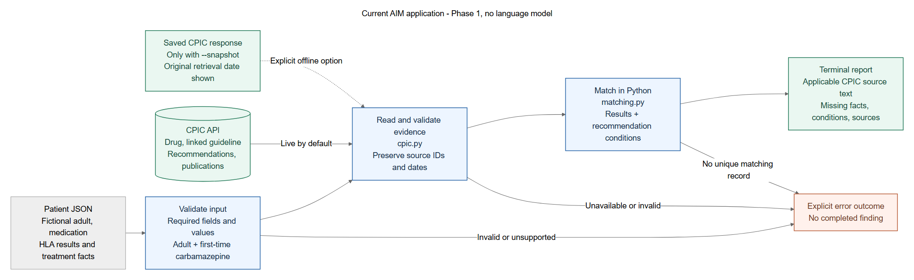

# AIM pharmacogenetics prototype

Give the application a fictional patient JSON file. It retrieves CPIC evidence,
matches the reported genetic results and treatment conditions in Python, and prints
the applicable guidance, missing information, and sources.

Currently supports **fictional adults considering carbamazepine for the first time**.
It reports genetic guidance, not overall medication suitability. No language model,
Ollama, Hugging Face account, or API key is needed.



The diagram describes the application that exists now. The editable diagram source
is [architecture.mmd](docs/architecture.mmd).

## Get the project

Use **uv on both macOS and Windows**, plus Git. No GPU is required. If uv is not
installed, follow the installation commands below. Clone the project in a terminal:

```sh
git clone --branch kush/aim-prototype https://github.com/cmkoenig01/Agent-Prototype.git
cd Agent-Prototype
```

Already have the repo? Save any local work, then run these commands from its root
instead of cloning again:

```sh
git fetch origin
git switch kush/aim-prototype
git pull --ff-only
```

Keep running the commands below from the repo root.

## Setup with uv (macOS and Windows)

If you already have uv, skip its installation. For a teammate who does not, use the
[official uv installer](https://docs.astral.sh/uv/getting-started/installation/):

macOS Terminal:

```sh
curl -LsSf https://astral.sh/uv/install.sh | sh
```

Windows PowerShell:

```powershell
powershell -ExecutionPolicy ByPass -c "irm https://astral.sh/uv/install.ps1 | iex"
```

Open a new terminal after installing uv. Then, from the repo root, on either platform:

```sh
uv --version
uv sync --locked
```

`uv sync --locked` creates or updates **one `.venv`** for this project. It installs
the application and development tools using `uv.lock`. The project selects Python
3.13 through `.python-version`; uv can download it if needed. You do not need a
separate pip installation or a second environment.

To use the short `aim-pgx` command, activate that same environment:

| Platform | Activate in each new terminal |
| --- | --- |
| macOS (zsh/bash) | `source .venv/bin/activate` |
| Windows (PowerShell) | `.\.venv\Scripts\Activate.ps1` |

Activation just makes this terminal find the commands already installed in `.venv`.
Run `deactivate` to leave it. If activation is blocked or inconvenient, use the
`uv run` form explained below; it uses the same environment.

## Run

After installation and activation, use the same command with a different patient file:

```sh
aim-pgx --case examples/hla_b_positive_a_unknown.json
aim-pgx --case examples/hla_a_positive_alternatives_unknown.json
aim-pgx --case examples/both_negative.json
aim-pgx --case examples/both_results_missing.json
```

`aim-pgx` is the command installed by this project. `--case` specifies which fictional
patient JSON file to assess. It does not name a model or select a separate operating mode.
`python -m aim_pgx --case <file>` runs the same application. Use `aim-pgx --help` to
see all options.

The application retrieves evidence **live** by default. Add `--details` to include
the source comments, lookup keys, publication links, request URLs, and record versions:

```sh
aim-pgx --case examples/both_negative.json --details
```

For an offline run, explicitly select the dated CPIC response used by the tests:

```sh
aim-pgx --case examples/both_negative.json --snapshot tests/fixtures/cpic_carbamazepine.json
```

The report labels saved evidence as **SNAPSHOT** and shows the original retrieval
date. Live failures never silently switch to saved evidence. To save a new response,
add `--save-snapshot snapshots/cpic.json` to a live run. Existing files are not overwritten.

## Running without environment activation

On either macOS or Windows, this runs the same installed application without activation:

```sh
uv run --locked aim-pgx --case examples/both_negative.json
```

| Part | Meaning |
| --- | --- |
| `uv sync --locked` | Create/update `.venv` using the committed `uv.lock`; refuse an outdated lockfile |
| `uv run` | Run a command inside the project's environment; manual activation is unnecessary |
| `--locked` | Check that the lockfile matches the project; do not rewrite it |
| `aim-pgx` | The application being run |
| `--case examples/both_negative.json` | The input file passed to the application |

This is a wrapper around the same `aim-pgx` command, not a second installation or mode.

## Patient inputs and cases

The files in `examples/` are ordinary JSON files; copy one to create another case.
Every field is required:

| Field | Meaning / allowed values |
| --- | --- |
| `case_id` | A label for the fictional patient |
| `age` | Integer; assessment is limited to adults aged 18 or older |
| `medication` | `carbamazepine`; other medications are unsupported |
| `first_time_use` | Must be `true` for this prototype |
| `hla_b_1502` | Reported HLA-B*15:02 result: `positive`, `negative`, or `unknown` |
| `hla_a_3101` | Reported HLA-A*31:01 result: `positive`, `negative`, or `unknown` |
| `alternatives` | Alternative agents: `available`, `unavailable`, or `unknown` |

HLA-A and HLA-B are different genes; HLA-A*31:01 and HLA-B*15:02 name particular
versions, called alleles. Positive means reported present, negative means reported
not detected, and unknown means no reported result. Unknown is never changed to
negative, and ancestry is not used to infer a result.

| Example file | What it exercises |
| --- | --- |
| `hla_b_positive.json` | Both genetic results reported; HLA-B positive |
| `hla_b_positive_a_unknown.json` | HLA-B positive; HLA-A result missing |
| `hla_a_positive_alternatives.json` | HLA-A positive; alternatives available |
| `hla_a_positive_no_alternatives.json` | HLA-A positive; alternatives unavailable |
| `hla_a_positive_alternatives_unknown.json` | Alternative availability unknown; conditional branches shown |
| `both_negative.json` | Both checked alleles reported negative |
| `one_result_missing.json` | HLA-B negative; HLA-A unknown |
| `both_results_missing.json` | No reported results; no patient recommendation selected |
| `unsupported_medication.json` | Unsupported medication error |
| `drug_class.json` | Drug-class request; a specific medication is needed |

## How to read the output

- `matched`: a record matches the reported results and treatment context.
- `matched_with_missing`: applicable HLA-B-positive guidance was found; HLA-A remains unknown.
- `partial`: a CPIC "No Result" record was found, but genetic coverage is incomplete.
- `needs_information`: necessary facts are missing; conditional guidance may be shown.

Recommendations are CPIC source text. The application preserves their conditions and
identifies unresolved facts instead of selecting a branch without the needed input.
An empty or failed lookup never becomes a reassuring finding.

Exit code 0 means the assessment completed, including outcomes with missing facts.
Errors return code 2; Ctrl+C returns 130.

## Where the code lives

| File in `src/aim_pgx/` | Responsibility |
| --- | --- |
| `cli.py` | Read command options and run the assessment |
| `models.py` | Data structures for patient facts, CPIC records, and findings |
| `scope.py` | Check supported medication, age, and treatment history |
| `cpic.py` | Retrieve and validate evidence; read/write explicit snapshots |
| `matching.py` | Compare patient facts with CPIC lookup keys and conditions |
| `reporting.py` | Format the terminal result |
| `errors.py` | Named error outcomes |

`examples/` contains patient inputs. `tests/` checks retrieval, matching, inputs, and
failure behavior using a dated real CPIC response. The teammate-owned root `agent.py`
is kept unchanged and is not part of this application's execution path.

## Checks and evidence sources

`uv sync --locked` already installs the development tools. With the environment active:

```sh
pytest
ruff check src tests
ruff format --check src tests
```

Without activation, prefix each command with `uv run --locked`, for example
`uv run --locked pytest`.

Tests run offline. A live assessment is a separate check of CPIC availability.
Evidence retrieval follows the drug's linked guideline, recommendations, and
publications. Requests use a 10-second timeout and at most one transient-failure retry.

- [CPIC API documentation](https://github.com/cpicpgx/cpic-data/wiki)
- [Carbamazepine/HLA guideline, Table 2](https://pmc.ncbi.nlm.nih.gov/articles/PMC5847474/)
- [Saved test evidence provenance](tests/fixtures/README.md)

Setup references: [uv installation](https://docs.astral.sh/uv/getting-started/installation/)
and [uv locking and syncing](https://docs.astral.sh/uv/concepts/projects/sync/).

## Planned development

The [phased roadmap](docs/ROADMAP.md) is a discussion draft for adding a useful
clinician-facing assistant. Only Phase 1 exists today; later phases are proposals
to review before changing application code.
